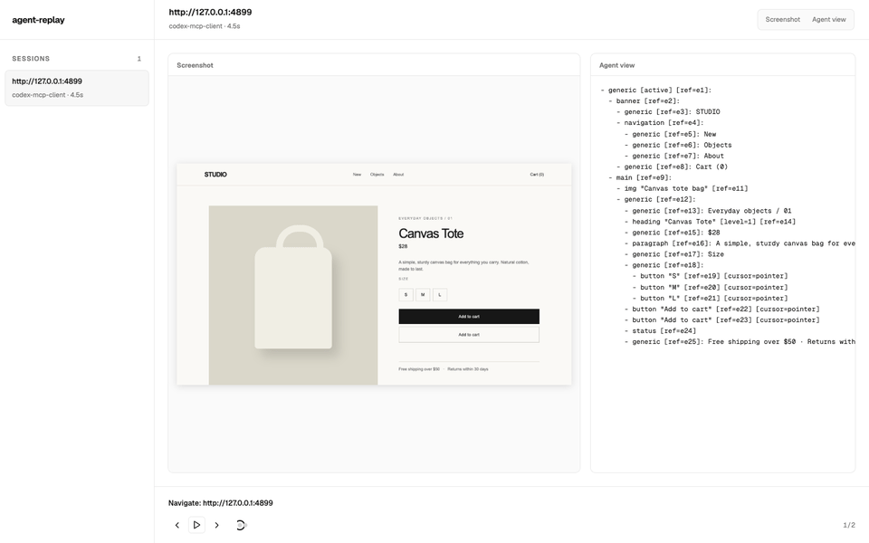

# agent-replay



**See what your agent saw.**

Session replay for browser agents, on your machine. No SDK, no account, no cloud.

```bash
# In this repository
bun install
bun run build
node dist/cli.js setup
node dist/cli.js
```

`setup` prints ready-to-paste MCP snippets for Claude Code, Claude Desktop, Cursor, VS Code, and Codex. Confirm once to add them. Existing server entries are preserved and existing config files are backed up first. For example, on a local checkout:

```json
{
  "mcpServers": {
    "agent-replay": {
      "command": "node",
      "args": ["/absolute/path/to/agent-replay/dist/cli.js", "mcp"]
    }
  }
}
```

```toml
[mcp_servers.agent-replay]
command = "node"
args = ["/absolute/path/to/agent-replay/dist/cli.js", "mcp"]
```

The setup command replaces the example path with this checkout's actual path. The planned published command is `npx agent-replay setup`, but **do not run it yet**: the npm name currently belongs to an unrelated project. This checkout works locally with Node 20+ after the Bun build.

**Local only. No account, no cloud, no telemetry.**

## Use it with your agent

Ask a configured agent to open a site with the `agent-replay` browser tools. Open `http://localhost:4747` to play the saved session. Each step pairs the screenshot taken after the action with the accessibility snapshot returned to the agent. The action line shows the target, errors, and warnings for elements with the same name or no name. Space plays or pauses; arrow keys move between steps. Session and step are saved in the URL.

The proxy forwards the official Playwright MCP tool calls and results unchanged. It launches Chrome, connects Playwright MCP through CDP, and takes screenshots from a separate connection. It never calls the snapshot tool on the agent's behalf, so its element refs stay valid. The browser screenshot is taken after each action. One proxy process creates one session in `~/.agent-replay/sessions/<sessionId>/` with `steps.jsonl` and one PNG per step.

Typed password and payment card values are masked in saved text. Their fields are covered with solid boxes in screenshots. The proxy only sees MCP tool calls and results; it does not see browser network traffic. `src/cdp-extension.ts` marks the single place for a future CDP listener.

## Supported clients

Claude Code, Claude Desktop, Cursor, VS Code agents, and Codex can connect to the stdio MCP server. It works with any client that supports stdio MCP. It does not cover agents using their own built-in or cloud browser, including ChatGPT agent, Claude in Chrome, and Comet.

## Who it helps

- Developers can see why a browser agent clicked the wrong element.
- E-commerce and web teams can watch an agent try a size picker, add to cart, and checkout flow, then find where it gets stuck.
- Web analysts can replay the same journey; tracking hits are reserved for a later version.

## Commands

| Command | Action |
|---|---|
| `node dist/cli.js setup` | Print client configs and optionally add them after confirmation. |
| `node dist/cli.js mcp` | Run the stdio proxy. Extra arguments pass to Playwright MCP. |
| `node dist/cli.js` | Open the player at `http://localhost:4747`. |
| `node dist/cli.js clear` | Delete local sessions after confirmation. |

## Development

```bash
bun install
bun run check
bun test
bun run build
```

The build emits plain ESM for Node 20+. Bun is only used to develop, test, and build. Tests compare real Playwright MCP results and refs with and without the proxy, verify steps and screenshots, and check sensitive field masking. A real Codex task against the included store demo produced a session where the first “Add to cart” click left the cart at zero and showed “Choose a size first.”

## Later

Network requests, other MCP tools, tracking hits, and deeper DOM recording.
